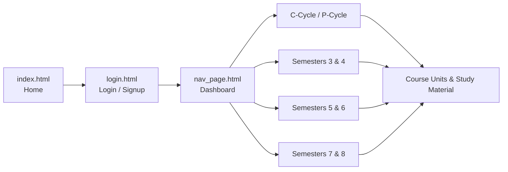

# 📚 Student E-Library Portal

[](https://student-e-library.vercel.app/)
[](https://developer.mozilla.org/en-US/docs/Web/Guide/HTML/HTML5)
[](https://developer.mozilla.org/en-US/docs/Web/CSS)
[](https://developer.mozilla.org/en-US/docs/Web/JavaScript)
[](https://www.bmsce.ac.in/)

> 🚀 **Live Demo**: Experience the live working portal at **[https://student-e-library.vercel.app/](https://student-e-library.vercel.app/)**

An online academic digital library and student resource repository built for students and faculty of **B.M.S. College of Engineering (BMSCE)**. This portal provides seamless access to digitized textbooks, lecture presentations, unit-wise notes, and reference materials across various engineering disciplines and semesters.

---

## 🌟 Key Features

- **Semester & Cycle-Wise Organization**:
  - Dedicated pages for First-Year **Chemistry Cycle (C-Cycle)** and **Physics Cycle (P-Cycle)**.
  - Granular, unit-by-unit (Units 1–5) syllabus breakdown for **Semesters III through VIII** (Computer Science & Engineering curriculum).
  - Direct integration with Google Drive and Google Slides for lecture materials and PDFs.
- **Dual-Mode Authentication Portal**:
  - Split-view toggle between **Student/Faculty** and **Admin** login interfaces.
  - Client-side validation ensuring valid BMSCE college email domain formats (e.g., `student.cs20@bmsce.ac.in`).
  - Account registration page with real-time field validation (name, email, password match).
- **Interactive Student Engagement**:
  - **FAQ Section**: Dynamic collapsible accordion answering common queries about resources and credentials.
  - **Feedback & Rating**: Interactive 5-star rating widget with feedback submission.
  - **Contribution & Donation**: UPI QR code integration to support portal maintenance.
- **Visual Design**:
  - Campus video background with playback speed controls and aesthetic typography.

---

## 📁 Repository Structure

```text
Student_E-Library/
├── 📄 index.html           # Landing page with video hero & main navigation
├── 📄 index.css            # Stylesheet for the landing page
├── 📄 login.html           # Dual-tab login page (Student/Faculty & Admin)
├── 📄 login.css            # Styling & toggle animations for login
├── 📄 login.js             # Client-side validation and routing logic
├── 📄 signup.html          # Registration form
├── 📄 signup.css           # Registration form styling
├── 📄 signup.js            # Real-time field validation for signup
├── 📄 nav_page.html        # Main dashboard routing to all semesters & cycles
│
├── 🎓 Academic Semesters:
│   ├── C-cyclesub.html     # C-Cycle (Maths 1, Chemistry, Mechanics, Electrical, Drawing)
│   ├── P-cyclesub.html     # P-Cycle (Maths 2, Physics, etc.)
│   ├── 3rdsemsub.html      # Semester III (COA, DS, Microprocessors, Maths, Java, etc.)
│   ├── 4thsemsub.html      # Semester IV (Linear Algebra, TFOC, DBMS, DAA, OS)
│   ├── 5thsemsub.html      # Semester V (AI, Networks, USP, Software Engg, etc.)
│   ├── 6thsemsub.html      # Semester VI (Machine Learning, Cryptography, RPA, etc.)
│   ├── 7thsemsub.html      # Semester VII (Cloud, Blockchain, NoSQL, Data Science, etc.)
│   ├── 8thsemsub.html      # Semester VIII (Green Computing, Big Data, etc.)
│   └── 4thsemsub.css       # Unified stylesheet for semester subject dropdowns
│
├── ℹ️ Informational Pages:
│   ├── AboutUs.html        # About the digital library mission
│   ├── Aboutus.css         # Styling for About page
│   ├── donat.html          # Donation page with UPI QR code
│   ├── donate.css          # Styling for donation page
│   ├── feedback.html       # Interactive 5-star feedback form
│   ├── feedback.css        # Star rating styling & transitions
│   ├── faq.html            # Collapsible accordion FAQ page
│   ├── faq.css             # FAQ styles and accordions
│   ├── admin.html          # Admin dashboard skeleton
│   └── admin.css           # Admin styling
│
└── 🖼️ Media & Assets:
    ├── B.M.S College of Engineering Central Library.mp4  # Campus library video
    ├── qr.png              # UPI Donation QR Code
    ├── 10s.jpg             # Hero background snapshot
    ├── 17s.jpg             # Secondary snapshot
    └── 26.30s.jpg          # Alternate background snapshot
```

---

## 🚀 Getting Started

### 🌐 Live Portal
You can directly access and use the live application without needing to clone or run it locally:  
👉 **[https://student-e-library.vercel.app/](https://student-e-library.vercel.app/)**

### 💻 Running Locally

#### Prerequisites
No special runtime or build tools are required! All you need is a modern web browser (Chrome, Edge, Firefox, or Safari).

### Running Locally Setup
1. **Clone the repository**

2. **Open the application**:
   - Double-click `index.html` to open it in your browser.
   - Alternatively, serve it via a local development server (such as the VS Code **Live Server** extension) for the best experience:
     - Right-click `index.html` in VS Code ➔ **Open with Live Server**.

---

## 🧭 User Flow



1. **Home (`index.html`)**: Browse general information, college branding, or navigate to support/FAQ pages.
2. **Login (`login.html`)**: Log in with your BMSCE college credentials (`@bmsce.ac.in`) or switch to Admin mode.
3. **Dashboard (`nav_page.html`)**: Select your current engineering semester or cycle.
4. **Subject Resources (`*sub.html`)**: Hover over any course module to reveal the dropdown containing links for **Units 1 through 5**.

---

## 🛠️ Tech Stack & Integrations

- **Markup & Layout**: HTML5, Semantic Elements
- **Styling**: CSS3 (Flexbox, Dropdowns, Sliding Toggles, Media Queries)
- **Scripting**: Vanilla JavaScript (ES6+, DOM API, Regular Expressions)
- **Icons & Typography**:
  - [FontAwesome 5](https://fontawesome.com/)
  - [Google Fonts](https://fonts.google.com/) (*Poppins*, *Playfair Display*, *Work Sans*, *Roboto*)
- **Cloud & External Services**:
  - Google Drive & Google Slides for syllabus notes and presentations
  - Google Apps Script webhook integration for administrative actions

---

## 🤝 Contributing

Contributions are welcome to help expand the digital resources for all departments:
1. Fork the Project.
2. Create your Feature Branch (`git checkout -b feature/AddNotesSem5`).
3. Commit your Changes (`git commit -m 'Add unit notes for Semester 5'`).
4. Push to the Branch (`git push origin feature/AddNotesSem5`).
5. Open a Pull Request.

---

## 👤 Author

Developed and maintained by **[PujithBS](https://github.com/PujithBS)**  
B.M.S. College of Engineering, Bengaluru
